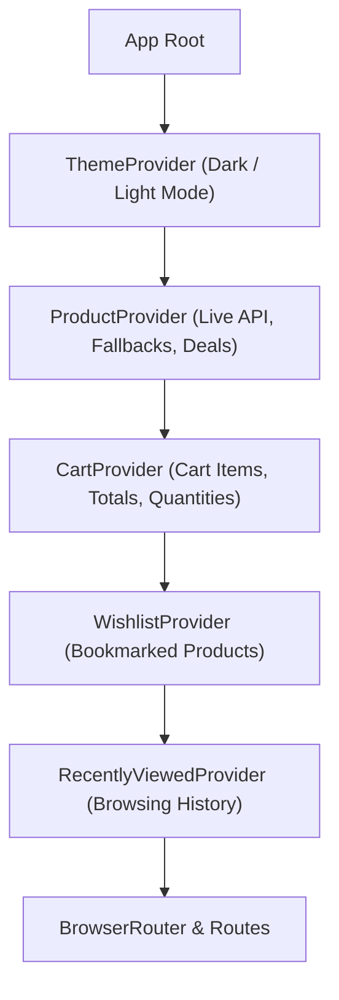

<div align="center">

# FlashStore E-Commerce

### A modern, high-performance storefront featuring live API product ingestion, dynamic multi-attribute filtering, interactive cart & wishlist, GSAP micro-animations, and responsive dark/light themes.

**Built with React 19, Vite, Tailwind CSS v4, GSAP 3, and DummyJSON API.**

<br />

[](https://react.dev/)
[](https://vitejs.dev/)
[](https://tailwindcss.com/)
[](https://reactrouter.com/)
[](https://greensock.com/gsap/)
<br />
[](https://dummyjson.com/)
[](https://lucide.dev/)
[](https://eslint.org/)
[](https://nodejs.org/)

<br />

[Features](#features) • [Quick Start](#quick-start) • [Technology Stack](#technology-stack) • [Architecture](#architecture--state-management) • [API Integration](#api-integration--data-normalization) • [Pages & Routing](#pages--routing) • [Project Structure](#project-structure)

</div>

---

## Table of Contents

- [Features](#features)
- [Technology Stack](#technology-stack)
- [Architecture & State Management](#architecture--state-management)
- [API Integration & Data Normalization](#api-integration--data-normalization)
- [Project Structure](#project-structure)
- [Quick Start](#quick-start)
- [Pages & Routing](#pages--routing)
- [Scripts](#scripts)
- [Contributing](#contributing)
- [License](#license)

---

## Features

- ⚡ **Live API Product Ingestion**: Connects to the external DummyJSON REST API to retrieve and display ~194 live products across 5 core retail departments.
- 🔍 **Real-Time Search & Multi-Attribute Filtering**: 
  - Instant client-side search across product name, brand, description, and categories.
  - Interactive price range slider with dynamic maximum ceiling.
  - Sorting options: *Default (Featured)*, *Price: Low to High*, *Price: High to Low*, *Top Rated*, and *Biggest Discount*.
  - Synchronized URL query parameters (`?category=...&search=...`).
- 🛒 **Persistent Shopping Cart**: Full shopping cart management with instant quantity increments, subtotal calculations, and localStorage persistence.
- ❤️ **Interactive Wishlist**: One-click product bookmarking with count indicators and instant item toggling.
- 🌓 **Dual Theme Engine**: Seamless light and dark mode toggling powered by Tailwind CSS v4 custom variants (`@custom-variant dark`) and persistent local storage.
- 🎨 **GSAP Micro-Animations & Glow Effects**: Smooth hero entrance sequences with StrictMode-safe context lifecycle handling, card hover physics, and neon visual accents.
- 🛡️ **Resilient Fallback Mechanism**: Automatic fallback to a curated offline product catalog if network issues or API outages occur.
- 📱 **Mobile-First & Fully Responsive**: Intuitive layout with touch-friendly category carousels on mobile and collapsible desktop sidebars.
- 📄 **Comprehensive Storefront Routing**: Dedicated pages for Categories, Flash Deals, Help Center & FAQ, Returns & Refunds, Shipping, Contact, Privacy, Terms, and About.
- ⬆️ **Auto Scroll-To-Top**: Smooth scroll reset on route changes to ensure users start at the top of every new page.

---

## Technology Stack

| Technology | Version | Purpose |
| :--- | :--- | :--- |
| **[React](https://react.dev/)** | `^19.2.8` | Declarative component UI library with modern Concurrent Features |
| **[Vite](https://vitejs.dev/)** | `^8.3.0` | Ultra-fast next-generation frontend build tooling and HMR |
| **[Tailwind CSS](https://tailwindcss.com/)** | `^4.3.3` | Utility-first styling engine with CSS variables and custom dark variants |
| **[React Router](https://reactrouter.com/)** | `^7.18.4` | Client-side routing, route transitions, and URL search param synchronization |
| **[GSAP](https://greensock.com/gsap/)** | `^3.15.0` | High-performance entrance and hover physics micro-animations |
| **[Lucide React](https://lucide.dev/)** | `^1.59.0` | Clean, lightweight icon suite |
| **[DummyJSON API](https://dummyjson.com/)** | REST | External product catalog, reviews, stock, and pricing data source |
| **[ESLint](https://eslint.org/)** | `^10.10.0` | Code quality, React 19 hook linting, and Fast Refresh validation |

---

## Architecture & State Management

FlashStore utilizes a layered Context Provider tree to isolate concerns, provide centralized caching, and prevent prop-drilling:



### Context Breakdown:
* **`ProductProvider`**: Manages asynchronous API fetching, caching in memory, fallback delegation, rating sorting, and deals filtering.
* **`CartProvider`**: Handles add/remove operations, quantity limits against product stock, total price calculation, and `localStorage` persistence.
* **`WishlistProvider`**: Manages liked product IDs and synchronizes badges across navigation.
* **`ThemeProvider`**: Syncs the `dark` class on `document.documentElement` and saves user preference.
* **`RecentlyViewedProvider`**: Tracks the last 8 visited products for quick re-discovery.

---

## API Integration & Data Normalization

FlashStore consumes live data from `https://dummyjson.com/products` while ensuring that the data conforms to a unified internal schema:

```javascript
// Internal Product Schema
{
  id: 1,
  name: "Essence Mascara Lash Princess",
  category: "Beauty",            // Normalized from sub-category
  price: 9.99,
  oldPrice: 11.16,               // Computed from discount percentage
  discountPercentage: 10,
  rating: 4.6,
  reviews: 132,                  // Formatted reviews count
  reviewsList: [...],            // Live customer comments & reviewer names
  stock: 99,
  img: "https://...",            // High-resolution WebP thumbnail
  images: ["https://..."],       // Product image gallery
  brand: "Essence",
  sku: "BEA-ESS-001",
  warranty: "1-Year Warranty",
  shipping: "Free shipping over $50",
  returnPolicy: "30-Day Hassle-Free Returns"
}
```

### Category Normalization
Subcategories from the API are mapped directly to FlashStore's core retail departments:
* `smartphones`, `laptops`, `tablets`, `mobile-accessories` $\rightarrow$ **Electronics**
* `mens-shirts`, `womens-dresses`, `shoes`, `watches`, `bags` $\rightarrow$ **Fashion**
* `furniture`, `home-decoration`, `kitchen-accessories`, `groceries` $\rightarrow$ **Home**
* `beauty`, `fragrances`, `skin-care` $\rightarrow$ **Beauty**
* `sports-accessories`, `motorcycle`, `vehicle` $\rightarrow$ **Sports**

---

## Project Structure

```text
E-Commerce/
├── public/                     # Static public assets
├── src/
│   ├── components/             # Reusable UI components
│   │   ├── Footer.jsx          # Comprehensive footer with active links & newsletter
│   │   ├── Navbar.jsx          # Header with logo, live search, cart/wishlist counters
│   │   ├── ProductCard.jsx     # Card with hover zoom, sale badge, & quick add
│   │   ├── ProductSkeleton.jsx # Pulse skeleton loading cards
│   │   └── ScrollToTop.jsx     # Route transition scroll position reset
│   ├── context/                # React Context Providers
│   │   ├── CartContext.jsx     # Shopping cart state & persistence
│   │   ├── ProductContext.jsx  # API product loading, search, & deals
│   │   ├── RecentlyViewedContext.jsx # Browsing history
│   │   ├── ThemeContext.jsx    # Dark / Light mode toggle
│   │   └── WishlistContext.jsx # Wishlist storage & actions
│   ├── data/
│   │   └── products.js         # Curated local fallback catalog
│   ├── pages/                  # Store pages & route views
│   │   ├── About.jsx           # Company mission, stats, and values
│   │   ├── Auth.jsx            # Authentication view components
│   │   ├── Cart.jsx            # Shopping cart management
│   │   ├── Categories.jsx      # Department cards & product counts
│   │   ├── Checkout.jsx        # Order checkout & billing summary
│   │   ├── Contact.jsx         # Support form & direct contact information
│   │   ├── Help.jsx            # Searchable FAQ knowledge base
│   │   ├── Home.jsx            # Hero section, featured items & flash sales
│   │   ├── Login.jsx           # User sign-in
│   │   ├── Orders.jsx          # Order fulfillment tracking
│   │   ├── Privacy.jsx         # GDPR & CCPA privacy policy
│   │   ├── ProductDetails.jsx  # Gallery, specs, reviews, & related items
│   │   ├── Products.jsx        # Catalog with filters, sort, & price slider
│   │   ├── Profile.jsx         # User account profile
│   │   ├── Register.jsx        # New user registration
│   │   ├── Returns.jsx         # 30-day return policy & refund timelines
│   │   ├── Sale.jsx            # Flash savings & clearance deals
│   │   ├── Shipping.jsx        # Shipping tiers, transit times, & carriers
│   │   └── Wishlist.jsx        # Saved products gallery
│   ├── services/
│   │   └── productService.js   # DummyJSON API client & data normalizer
│   ├── App.css                 # Tailwind CSS v4 import & theme variables
│   ├── App.jsx                 # Router registration & provider composition
│   └── main.jsx                # Application root entry point
├── eslint.config.js            # ESLint flat config with Vite rules
├── package.json                # Project dependencies and npm scripts
└── vite.config.js              # Vite configuration with Tailwind plugin
```

---

## Quick Start

### Prerequisites
- **Node.js**: `v18.0.0` or higher (Node 20+ recommended)
- **npm**: `v9.0.0` or higher (or `pnpm` / `yarn`)

### Installation

1. **Clone the repository:**
   ```bash
   git clone https://github.com/Kofi-Kakah/E-Commerce.git
   cd E-Commerce
   ```

2. **Install dependencies:**
   ```bash
   npm install
   ```

3. **Start the local development server:**
   ```bash
   npm run dev
   ```

4. **Open in your browser:**
   ```text
   http://localhost:5173
   ```

---

## Pages & Routing

| Path | Page Component | Description |
| :--- | :--- | :--- |
| `/` | `Home` | Hero banner, value props, category grid, top-rated products & flash deals |
| `/products` | `Products` | Full catalog with category sidebar, price slider, and multi-field search |
| `/product/:id` | `ProductDetails` | High-res image gallery, stock status, specs, reviews, & related products |
| `/categories` | `Categories` | Visual department showcase with direct collection links |
| `/sale` | `Sale` | Discounted deals with interactive threshold filters (10%+, 20%+ off) |
| `/cart` | `Cart` | Interactive cart table with quantity adjusters and order total |
| `/checkout` | `Checkout` | Shipping address form, payment options, and order placement |
| `/wishlist` | `Wishlist` | Saved products list with instant add-to-cart |
| `/orders` | `Orders` | Order history and fulfillment delivery status |
| `/profile` | `Profile` | User account settings and details |
| `/login` | `Login` | User account sign-in |
| `/register` | `Register` | New customer registration |
| `/help` | `Help` | Searchable knowledge base with categorized FAQ accordions |
| `/returns` | `Returns` | 3-step return instructions, eligibility terms, and refund timelines |
| `/shipping` | `Shipping` | Delivery tiers, rate matrix, carrier partners, and tracking instructions |
| `/contact` | `Contact` | Customer support ticket form, operating hours, and location info |
| `/about` | `About` | Brand history, customer milestones, and core values |
| `/privacy` | `Privacy` | Comprehensive GDPR/CCPA-compliant privacy policy |
| `/terms` | `Terms` | Terms of Service, billing conditions, and dispute policies |

---

## Scripts

In the project directory, you can run:

| Command | Action |
| :--- | :--- |
| `npm run dev` | Runs the development server at `http://localhost:5173` with instant HMR |
| `npm run build` | Compiles and bundles production-ready assets into the `dist/` directory |
| `npm run preview` | Locally preview the production build output |
| `npm run lint` | Runs ESLint across all `.js` and `.jsx` files to ensure code quality |

---

## Contributing

Contributions, issues, and feature requests are welcome!

1. Fork the repository
2. Create your feature branch (`git checkout -b feature/AmazingFeature`)
3. Commit your changes (`git commit -m 'Add some AmazingFeature'`)
4. Push to the branch (`git push origin feature/AmazingFeature`)
5. Open a Pull Request

---

## License

Distributed under the **MIT License**. See `LICENSE` for more information.

<div align="center">
  <sub>Built with ❤️ by the FlashStore Team.</sub>
</div>
